<div align="center">

# Assemble<span style="color:#3b82f6">X</span>

**你的 AI 電子實作助教**

說出想做的東西 → AI 選零件、接好線 → 通電前先檢查 → 一步一步帶你插上麵包板

`Tauri 2` · `React 18` · `Three.js` · `SwiftUI` · `ARKit / RealityKit` · `KDAN ComPDF`

</div>

---

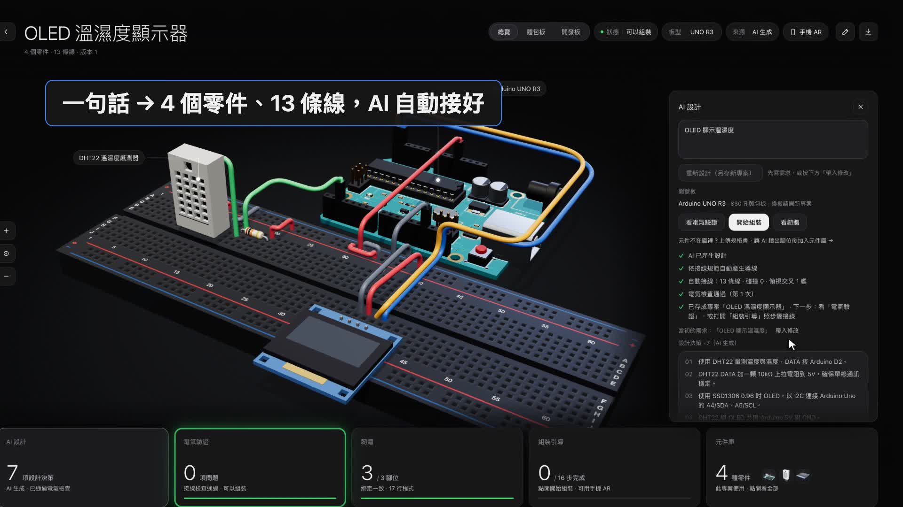

## 為什麼做這個

第一次學 Arduino，最常卡住的地方不是程式：
- 規格書看不懂。
- 線不知道怎麼插。
- 怕一接錯，零件就燒掉。

課堂上老師一個人，也顧不到全班每一塊麵包板。

AssembleX 把這段過程交給一個隨時在旁邊的 AI 助教：
- 你說想做什麼，它設計電路、說明每個零件為什麼這樣接。
- 通電之前先幫你檢查。
- 用電腦 3D 或手機 AR，一步一步帶你接到真的麵包板上。

## 功能

| | 功能 | 說明 |
|---|---|---|
| 🧠 | **一句話設計電路** | 輸入「OLED 顯示溫濕度」，AI 挑選元件、配腳位、擺放位置，並寫出每個設計決策的理由 |
| 🔌 | **自動接線** | 照接線規範自動產生導線：選孔、走電源軌、避開碰撞，不靠 AI 亂挑孔位 |
| ✅ | **通電前檢查** | 短路、斷路、腳沒插好、元件重疊都會檢查；沒通過就交回 AI 修正，最多三次 |
| ✋ | **手動調整** | 學生可以自己移動零件、改走線，檢查立刻重算，按一下就能重新接線 |
| 📄 | **規格書匯入（KDAN ComPDF）** | 丟進一或多份 PDF 規格書，自動讀出腳位、尺寸與電氣規格，每個數值都標出來自哪一份、第幾頁 |
| 🧊 | **從圖面畫出 3D 模型** | 依規格書裡的外形圖生成 3D 模型，不是一個方塊 |
| 🔗 | **外接元件** | 插不進麵包板的零件（例如排線接頭的 LD06）會外接在板子旁邊，不會被換成別的零件 |
| 🧭 | **逐步組裝引導** | 每一步標出哪隻腳插哪個孔，黃框直接標在 3D 麵包板上，進度自動保存 |
| 📱 | **手機 AR** | iPhone 辨識實體麵包板（830／400／170 孔），把要插的孔和線疊在相機畫面上，進度和電腦同步 |
| 💾 | **韌體與專案管理** | 產生腳位一致的 Arduino 專案；專案可搜尋、複製、刪除後救回 |

## 操作流程

### 1. 一句話設計電路

輸入想做的東西、選好開發板和麵包板，按「設計電路」。AI 會挑選元件、配好腳位，並在面板寫出每個零件為什麼這樣接。


### 2. 通電前先檢查

自動接線後，系統會檢查短路、斷路、腳沒插好和元件重疊。0 項問題才算通過，沒通過就交回 AI 修正。

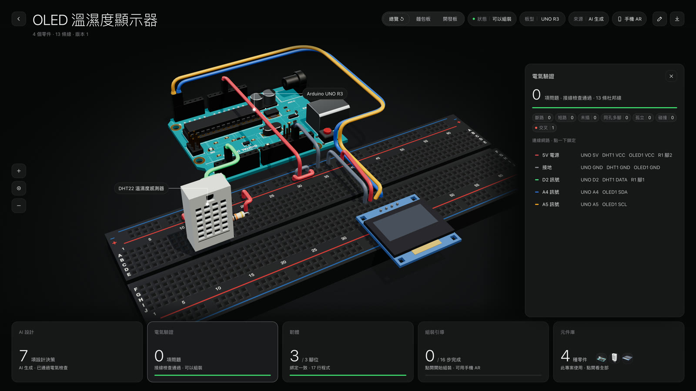

### 3. 自己動手改，錯了馬上知道

學生可以自己移動零件。挪錯了，檢查會立刻指出哪條線沒接上（左）；按「重新接線」就回到通過（右）。

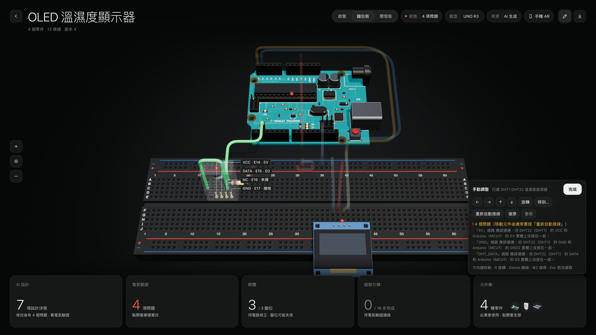 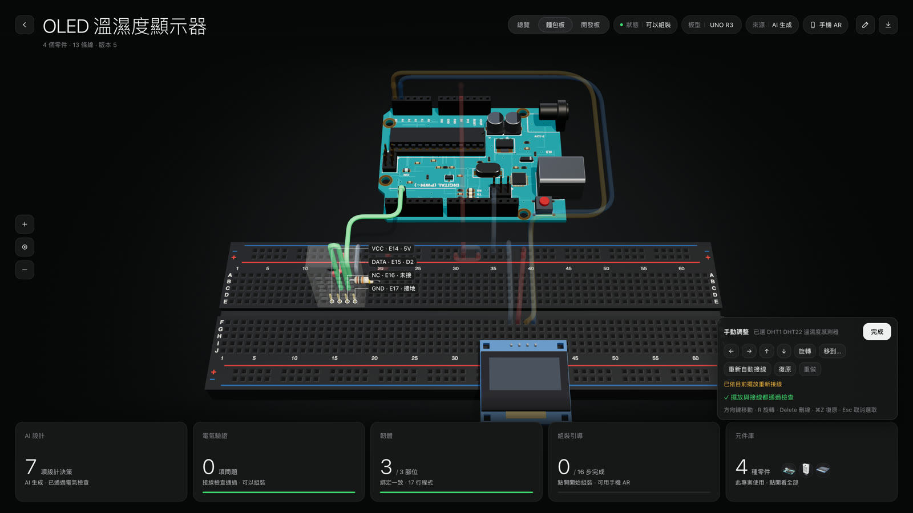

### 4. 逐步組裝引導

每一步標出哪隻腳插哪個孔，黃色標籤直接標在 3D 麵包板上，右邊是完整的步驟清單，進度會自動保存。

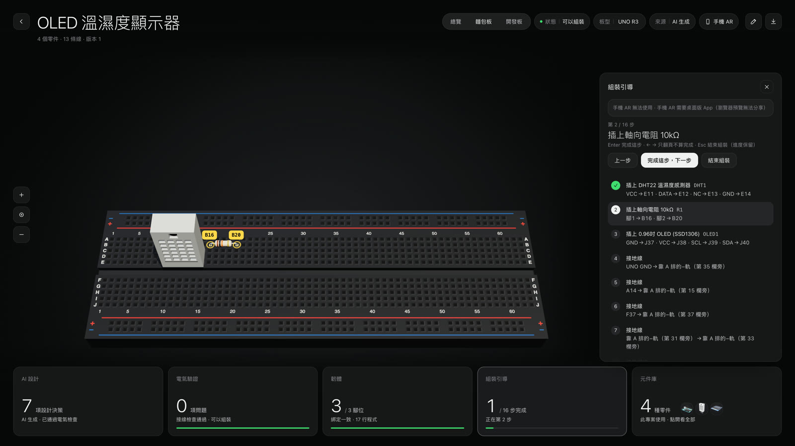

### 5. 專案管理

所有專案都在首頁，可以搜尋、排序、複製，刪除後 7 天內都能救回。

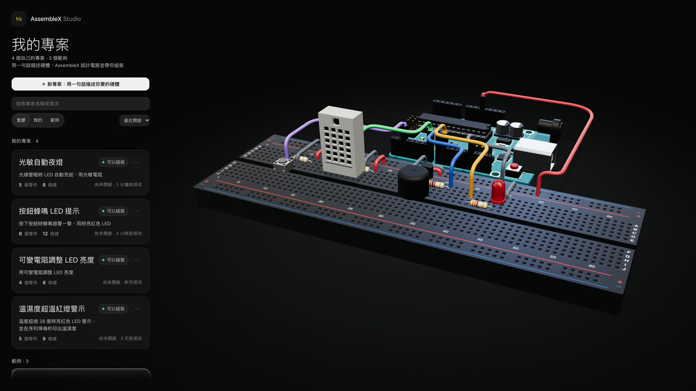

## 規格書解析：KDAN ComPDF

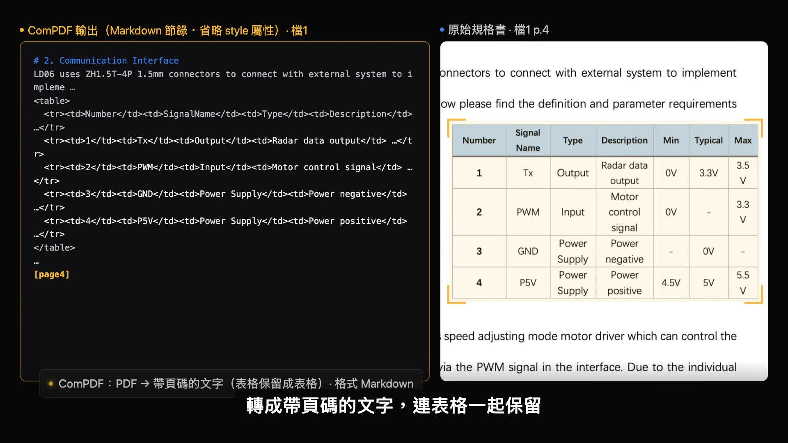 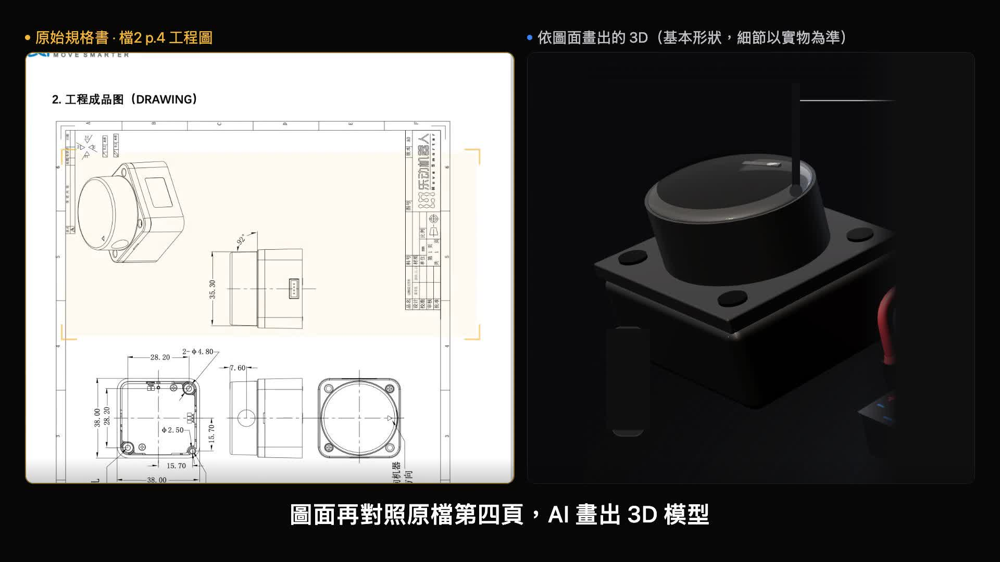

元件庫裡沒有的零件，可以從規格書新增：


- **多檔合併**：同一個元件可以一次丟入多份文件，例如英文 datasheet 加中文手冊，結果會標出每個值來自哪一份。
- **可追溯**：每隻腳、每個尺寸都附檔案與頁碼，點一下就能翻回原文對照。
- **誠實標示**：AI 推定的資料一律標成「待查證」，提醒接線前先對照實物。

### 匯入後直接拿來設計：插不進麵包板就外接

LD06 用的是 1.5 mm 排線接頭，插不進 2.54 mm 的麵包板。AI 會保留你指定的零件，把它擺在麵包板旁邊，用排線轉杜邦線接過去，不會偷偷換成別的感測器。

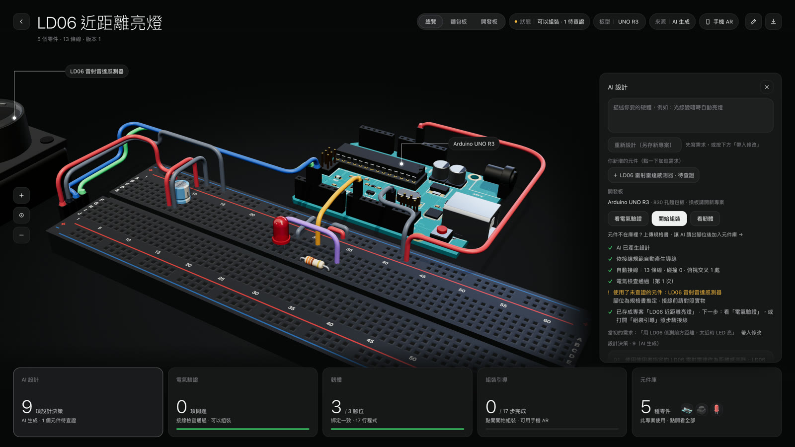


## 手機 AR

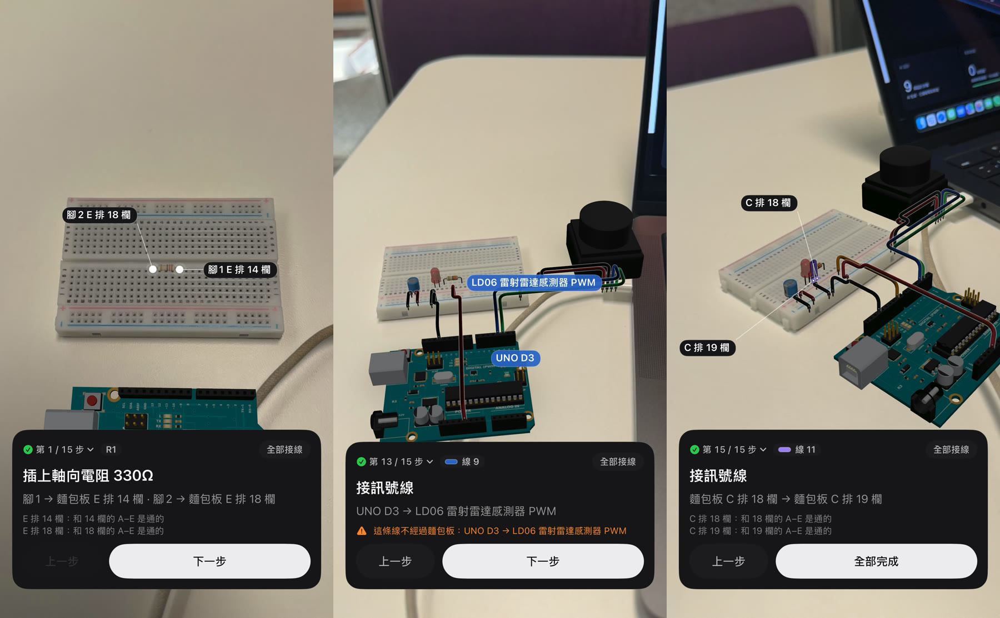

<sub>iPhone 實機錄影：第 1 步插電阻（左）、第 13 步把 UNO D3 接到外接的 LD06（中）、第 15 步全部完成（右）。</sub>

1. 桌面按「手機 AR」，用 iPhone 掃 QR code，或在同一個 Wi-Fi 自動找到電腦。
2. 鏡頭對準麵包板，App 會辨識板子大小與孔位。
3. 每一步要插的孔、要接的線直接疊在相機畫面上；外接元件的排線也會畫出來。
4. 按「完成這步」，電腦上的進度跟著更新。


## 架構

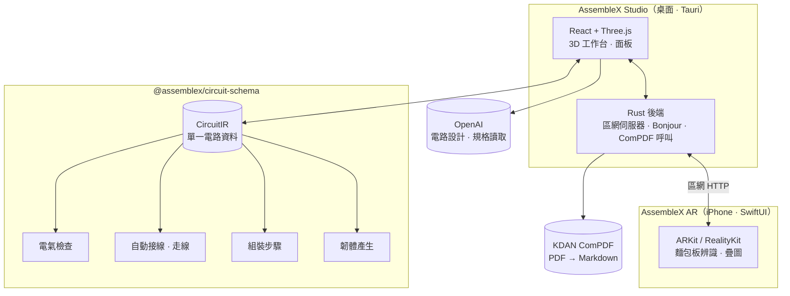

所有功能都讀同一份 **CircuitIR**：改了接線，檢查結果、組裝步驟、韌體腳位和手機畫面都會跟著更新。

## 專案結構

```
AssembleX/
├── apps/desktop/                 桌面版 Studio（Tauri + React）
│   ├── src/
│   │   ├── ui/                   首頁、工作台
│   │   ├── windows/              AI 設計、規格書匯入、組裝引導、元件庫、電氣檢查
│   │   ├── ai/                   電路設計、規格書解析、ComPDF 串接
│   │   ├── engine3d/             3D 麵包板、零件、規格書 3D 模型
│   │   ├── edit/                 手動調整零件與走線
│   │   ├── stores/               狀態管理（專案、AI 工作、規格書工作）
│   │   ├── link/                 傳給手機的資料
│   │   └── data/                 內建元件、開發板、範例專案
│   └── src-tauri/src/            Rust：區網伺服器、Bonjour、ComPDF
├── packages/circuit-schema/      共用電路核心（資料格式、檢查、接線、步驟、韌體）＋測試
├── AssembleX/                    iPhone App（SwiftUI）
│   ├── Link/                     連線電腦、資料格式
│   ├── Guide/                    組裝引導、2D 疊圖、3D／AR 場景
│   └── Vision/ ML/ Scanner/      麵包板辨識
├── AssembleX.xcodeproj
└── docs/                         架構、通訊協定、影片
```

## 開始使用

### 需求

- macOS（Apple Silicon）、Node.js 20+、Rust（Tauri 2）
- Xcode（iPhone App，需要實體 iPhone 才能用 AR）
- OpenAI API 金鑰；規格書匯入另需 [ComPDF](https://www.compdf.com) API 金鑰

### 桌面版

```bash
npm install                              # 在 repo 根目錄執行（npm workspaces）
cp apps/desktop/.env.example apps/desktop/.env.local
# 填入 VITE_OPENAI_API_KEY 與 VITE_COMPDF_API_KEY（也可以之後在 App 介面裡設定）

npm run dev                              # 瀏覽器預覽 → http://localhost:5180
cd apps/desktop && npm run app:dev       # 桌面 App（開發模式）
cd apps/desktop && npm run app:build     # 打包 .app / .dmg
```

> `.env.local` 不會進 git，請勿把金鑰寫進其他檔案。

### iPhone App

```bash
open AssembleX.xcodeproj                 # 選擇裝置後 Run
```

手機和電腦連同一個 Wi-Fi，桌面按「手機 AR」掃 QR code 即可連線。

### 測試

```bash
npm test                                 # circuit-schema：電氣檢查、自動接線、走線、組裝步驟、韌體
```
